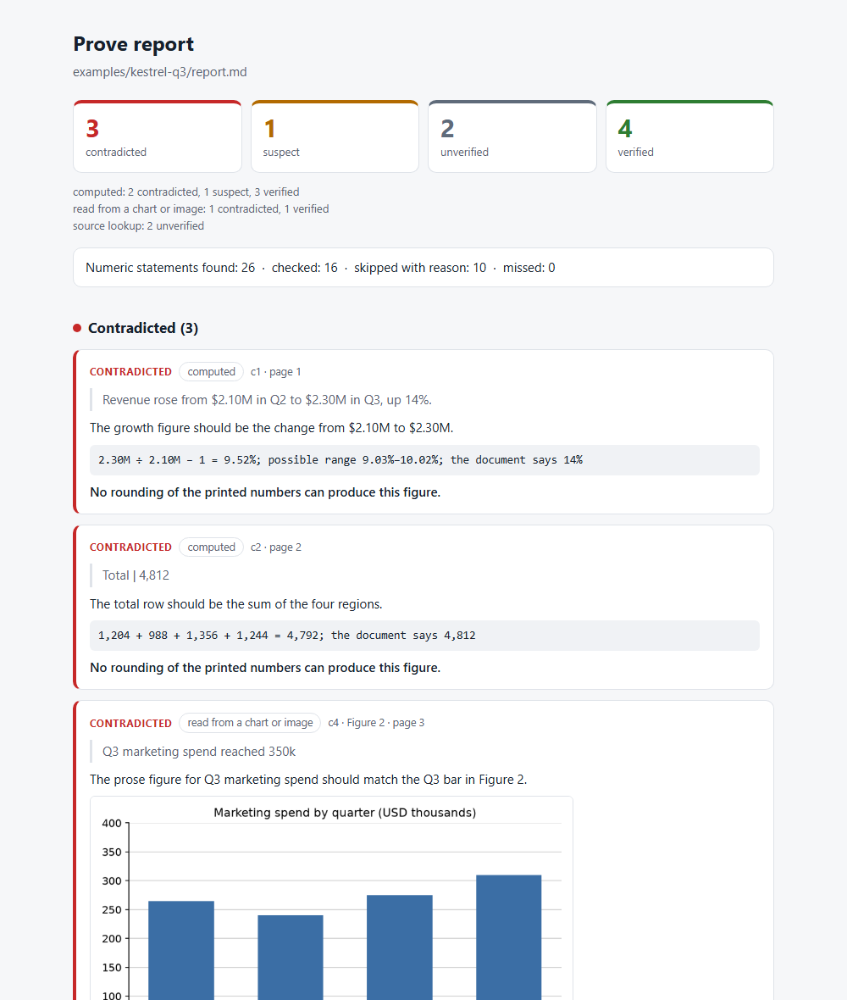

# Prove

[](https://github.com/enestanerr/prove/actions/workflows/ci.yml)
[](LICENSE)


**Audit every number, chart and citation in a document. Verdicts by code.**
A skill and plugin for Claude Code, built for Claude Fable 5.2, with a plain Python CLI
underneath.

Claude reads the document and proposes what to check. A deterministic program,
`provecheck`, recomputes each figure and decides the verdict. The model never gets to
say whether a claim is right.



## Install and run

In Claude Code:

```
/plugin marketplace add enestanerr/prove
/plugin install prove@enestanerr
```

On Claude Code 2.1.275 or later the same thing is one step:
`/plugin install prove --marketplace enestanerr/prove`

Then ask in plain words:

```
Audit report.pdf
```

or type `/prove:prove report.pdf`. You get a summary in the chat and an HTML report in
`prove-work/`.

## What a report looks like

Three claims from [`examples/kestrel-q3`](examples/kestrel-q3), exactly as `provecheck`
printed them:

> **contradicted** · computed · page 1
> *Revenue rose from $2.10M in Q2 to $2.30M in Q3, up 14%.*
> `2.30M ÷ 2.10M − 1 = 9.52%; possible range 9.03%–10.02%; the document says 14%`
> No rounding of the printed numbers can produce this figure.

> **suspect** · computed · page 1
> *Newsletter subscribers grew from 2.1M to 2.3M over the same period, also up 14%.*
> `2.3M ÷ 2.1M − 1 = 9.52%; possible range 4.65%–14.63%; the document says 14%`
> Possible only if the inputs sit at the edge of their rounding.

> **verified** · computed · page 2
> *East accounted for 28.3% of orders*
> `1,356 ÷ (1,204 + 988 + 1,356 + 1,244) = 28.30%; the document says 28.3%`
> Recomputing from the printed numbers gives the printed figure.

The first two look like the same mistake. They are not. "2.1M" can stand for anything
from 2.05M to 2.15M, and 2.05M → 2.349M is a 14.6% rise that prints as "from 2.1M to
2.3M". So the second sentence might be true, and Prove says `suspect` and shows the
range. With two decimals there is no such room, and the first is `contradicted`.

That is the rule: **`contradicted` means impossible under any rounding of what is
printed**, not "my recomputation differs".

Charts get the same treatment. Claude reads each bar twice, the second time from a 2×
crop, and gives an interval both times. `provecheck` compares the readings with the
numbers printed in the text, in the tables and on the chart itself:

> **contradicted** · read from a chart or image · Figure 2 · page 3
> *Q3 marketing spend reached 350k*
> `the Q3 bar in Figure 2 reads 300–320 (first reading 300–320, second reading 302–318); the document says 350`
> The chart reading and the printed number cannot both be right.

The full reports: [HTML](examples/kestrel-q3/prove-report.html),
[Markdown](examples/kestrel-q3/prove-report.md),
[JSON](examples/kestrel-q3/prove-report.json). There are two more examples, a survey
report and a Turkish quarterly memo, in [`examples/`](examples).

## How it works

```
document ──► model reads it ──► claims.json ──► provecheck ──► verdicts ──► report
             (proposes checks)                  (decides)
```

- The model copies each number **exactly as printed**, with the sentence it sits in,
  and says how it should be computed (`pct_change`, `sum`, `pct_of`, …). `provecheck`
  first looks for that number in the document text. A number that is not there, as
  printed, cannot be used. This is what stops a model from fixing a figure on the way
  in.
- Every printed number is treated as a rounded view of a true value. The claim is
  recomputed twice, once from the printed points and once with interval arithmetic
  over what the prints allow. Exact rational arithmetic, no floats.
- Every number in the document must end up checked or skipped with a reason. The
  report prints the count of each, and of the ones that were missed.

The contract between the two halves is [`docs/SPEC.md`](docs/SPEC.md).

| Verdict | Meaning |
| :- | :- |
| `verified` | Recomputing from what is printed gives what is printed |
| `contradicted` | No true values behind the printed numbers can produce the claim |
| `suspect` | Possible only if the inputs sit at the edge of their rounding |
| `unverified` | Not checked, with the reason. Never shown as an error |

Each verdict carries a tag for how it was reached: `computed` (arithmetic on grounded
numbers), `read` (rests on the model's reading of an image), `resolved` (a source
lookup). The summary keeps them apart.

## Measured results

Our own synthetic set, not a public benchmark. The corpus generator, the runners and
every result file are in [`evals/`](evals), so anyone can rerun this:
`uv run python evals/run_judge.py` and `uv run python evals/run_e2e.py --model <id> --n 30`.

<!-- measured:start -->
**Judge eval** (no model, runs in CI): given correct claims, is the verdict right?

Synthetic corpus v1, seed 1: 200 reports and 3 example documents, 2,577 claims.

| Planted errors contradicted | False alarms | Traps flagged |
| :- | :- | :- |
| 627/627 (100%) | 0 | 0 of 412 |

**End-to-end eval** (the model reads the document and writes the claims itself):

| Model | Run | Reports audited | Planted errors caught | False alarms | Knock-on flags | Traps flagged | Numbers missed | Chart readings holding the true value | Tokens in (with cache reads) / out per doc |
| :- | :- | :- | :- | :- | :- | :- | :- | :- | :- |
| Sonnet 5.5 (medium) | 2026-11-10 | 30/30 | 92/102 (90%) | 0 of 361 claims | 0 | 0 of 62 | 0 of 1,057 | 106/106 (100%) | 934,832 / 9,577 |

Caught by error type, Sonnet 5.5: chart_label 5/5 · chart_text 10/10 · crossref 3/3 · doi_missing 15/15 · misquote 11/11 · parts_sum 7/7 · pct_change 7/7 · pct_of 15/15 · pp_vs_pct 4/14 · sum 15/15.
Chart marks read: 106 of the 300 drawn in the corpus. Cited sources checked: 90 of 90. Cost: about $0.35 and 76 seconds per document.
Versions: Claude Code 2.1.319, plugin 0.1.0, provecheck 0.1.0.
<!-- measured:end -->

How to read the columns: a *false alarm* is a `contradicted` verdict on a number that
is right, or on a trap (a figure that only looks wrong: totals that differ by rounding,
hedged claims, growth rates that hold only because the inputs are rounded). A
*knock-on flag* is a `contradicted` verdict on a correct number that was computed from
a planted wrong one; the report marks these. *Chart readings holding the true value*
counts final readings that contain the true value, out of the marks the model read.

What these numbers do not show:

- Only the models in the table have been measured. Prove is built for Fable 5.2, but
  its row is missing until it has been run; the command above adds it.
- The weak row is `pp_vs_pct`. Given "improved from 46.4% to 52.0%, an increase of
  5.6%", the model usually reads the increase as points and proposes a check that
  passes. The judge is never asked the question.
- A run may contain documents that were run a second time. Each results folder has a
  `NOTES.md` that says which ones and why.

## What it does not do

- It does not judge opinions, forecasts or strategy.
- It does not know whether a source is right, only whether it exists and says what is
  quoted.
- It does not find errors that are consistent. If every figure in a report is wrong in
  the same way, the arithmetic still closes.
- A chart reading is still the model's work, and so is the choice of what to check.
  That is why those verdicts are tagged `read`, and why the coverage line exists.
- A clean report means the checked claims passed. It says how many were checked.

## Other ways to install

| Where | How |
| :- | :- |
| Claude Code | `/plugin marketplace add enestanerr/prove`, then `/plugin install prove@enestanerr` |
| Other agents (Codex, Cursor, …) | `npx skills add enestanerr/prove`, or copy the folder [`plugin/skills/prove`](plugin/skills/prove) into your agent's skills directory |
| claude.ai and Cowork | upload `prove-skill.zip` as a skill; code execution must be on. The zip is attached to each release, and `python tools/build_skill_zip.py` builds it from a clone |
| CLI | `pipx install "git+https://github.com/enestanerr/prove"` |

The CLI is not on PyPI yet. From the first tagged release on it will be
`pipx install provecheck`.

The skill itself needs only Python 3.10 or later: the judge travels with it as a single
file. PDF text and chart crops need PyMuPDF (`pip install pymupdf`). Without it the
skill still works on Markdown, HTML, CSV and text, and can crop PNG images.

## The CLI

`provecheck` is the judge on its own. It runs anywhere Python 3.10 runs and its core
needs nothing installed.

```
provecheck ingest  report.pdf -o doc.json --render-pages pages/   text, tables, page images
provecheck scan    doc.json                                       every numeric token
provecheck text    doc.json                                       the text of each page
provecheck check   claims.json --doc doc.json                     the verdicts
provecheck crop    --doc report.pdf --page 3 --box 0,0,1,0.5 -o crop.png
provecheck sources claims.json                                    DOIs, arXiv ids, URLs, quotations
provecheck report  verdicts.json --html --md --json --card
```

`provecheck report` exits with 1 when a claim is contradicted (`--fail-on suspect`
tightens it), so a claims file kept beside a document can gate CI. Writing the claims
file is the model's job today; `provecheck audit <doc>`, which does the reading step
with an API key, is planned for v0.2.

## Roadmap

- **v0.2** — a logic tier (stated rules checked with a solver, counterexample
  included), an opt-in gate that reminds Claude to audit a deliverable before it
  finishes, standalone `provecheck audit`, a GitHub Action, XLSX.
- **v0.3** — DOCX and PPTX, an MCP server, more resolvers and number formats.

## Related work

Recomputing numbers is not new, and Prove stands on other people's ideas.

- The [GRIM test](https://doi.org/10.1177/1948550616673876) (Brown & Heathers) and
  [statcheck](https://doi.org/10.3758/s13428-015-0664-2) (Nuijten et al.) showed that
  what a paper prints constrains what can be true behind it. The verdict rule here is
  that idea, applied to any printed number.
- [ai-fact-checker-claude-skill](https://github.com/BrickyStudios/ai-fact-checker-claude-skill)
  recomputes arithmetic and matches quotations in a Claude skill.
- [refchecker](https://github.com/markrussinovich/refchecker) validates academic
  reference lists.
- [Perci](https://github.com/jacksonjp0311-gif/Perci) verifies equations and citations
  in agent steps.
- Anthropic's financial-services plugin checks number consistency in decks and models.
- PlotPick, graph2table and WebPlotDigitizer turn chart images into data.

What Prove adds is the combination: verdicts that are sound under rounding, charts read
back against the document's own text, source lookups, and published false-alarm numbers.

## Contributing

A new relation, a source resolver, a number format, an example document: each is one
file and one test. [CONTRIBUTING.md](CONTRIBUTING.md) walks through adding a relation
start to finish. A report of a wrong verdict is the most useful issue you can open.

## Licence

MIT. See [LICENSE](LICENSE).
