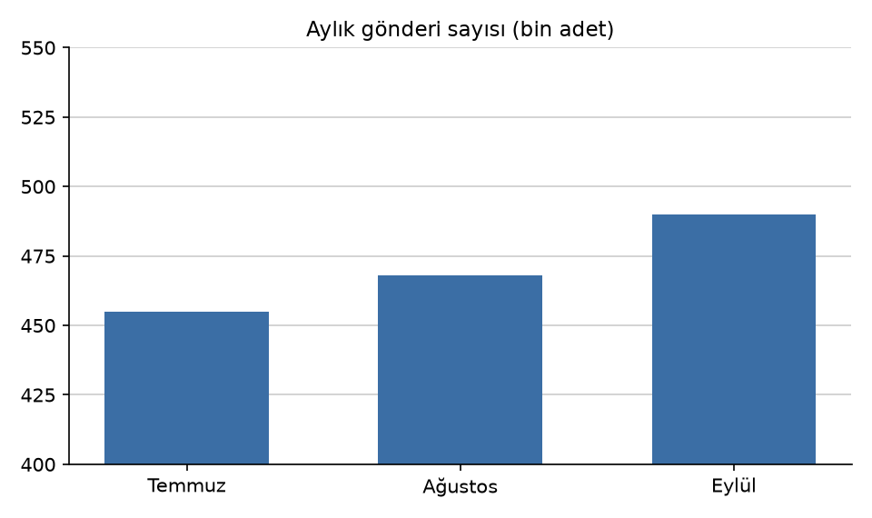

# Anadolu Kargo A.Ş. — 2026 3. Çeyrek Faaliyet Özeti

*Anadolu Kargo A.Ş. kurgusal bir şirkettir. Bu rapor, Prove'u göstermek için bilerek yerleştirilmiş hatalar içerir.*

## Özet

Gelir 2. çeyrekteki 48,6 milyon TL'den 3. çeyrekte 53,9 milyon TL'ye yükseldi; artış %10,9.

Teslim edilen gönderi sayısı 1.284.500'den 1.412.920'ye çıktı; bu %12 artış demek.

Zamanında teslimat oranı %94,2'den %96,0'a yükseldi; 1,8 puanlık bir iyileşme.

---

## Bölgelere göre gönderiler

| Bölge      | Gönderi (bin adet) |
| :--------- | -----------------: |
| Marmara    | 512,4              |
| İç Anadolu | 318,7              |
| Ege        | 271,3              |
| Diğer      | 310,5              |
| Toplam     | 1.412,9            |

Marmara, toplam gönderilerin %38,3'ünü oluşturdu.

Eylül ayında 520 bin gönderiyle çeyreğin en yüksek aylık değerine ulaşıldı.

---

## Filo

Filo 420 araçtan oluşuyor; bunların 124'ü, yani yaklaşık %30'u elektrikli.

92 günlük çeyrekte araç başına günde ortalama 36,6 teslimat yapıldı.
