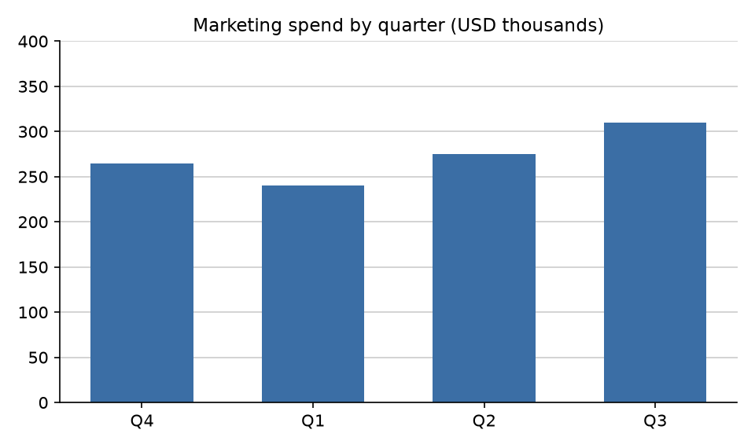

# Kestrel Outdoor Co. — Q3 2026 report

*Kestrel Outdoor Co. is fictional. This report contains planted errors and is used to demonstrate Prove.*

## Summary

Revenue rose from $2.10M in Q2 to $2.30M in Q3, up 14%. Newsletter subscribers grew from 2.1M to 2.3M over the same period, also up 14%.

Gross margin improved from 41.2% to 43.7%, a gain of 2.5 percentage points.

---

## Orders by region

| Region | Orders |
| :----- | -----: |
| North  | 1,204  |
| South  | 988    |
| East   | 1,356  |
| West   | 1,244  |
| Total  | 4,812  |

East accounted for 28.3% of orders, the largest share of any region.

---

## Marketing

Q3 marketing spend reached 350k, the highest of the last four quarters.

---

## References

[1] An example cited title (2021). doi:10.1234/example.2021.001

[2] Brown, N. J. L., & Heathers, J. A. J. (2017). The GRIM Test: A Simple Technique Detects Numerous Anomalies in the Reporting of Results in Psychology. doi:10.1177/1948550616673876
