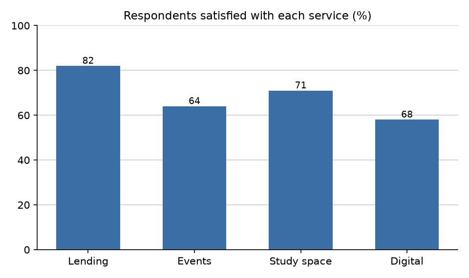

# Larkspur Public Library — Member Survey 2026

*Larkspur Public Library is fictional. This report contains planted errors and is used to demonstrate Prove.*

## Summary

The 2026 member survey was sent to 3,200 members and 1,184 responded, a response rate of 37.0%.

Overall satisfaction rose from 71.4% in 2025 to 76.9% in 2026, an increase of 5.5%.

About 60% of respondents visit the library at least once a month.

---

## Visits and services

| Frequency  | Respondents |
| :--------- | ----------: |
| Weekly     | 312         |
| Monthly    | 405         |
| Less often | 467         |
| Total      | 1,184       |

Weekly visitors make up 26.4% of respondents.

Lending scored highest, with 82% of respondents satisfied.

---

## Staff time and programme costs

Staff time was split evenly across three programmes: lending 33.3%, events 33.3% and outreach 33.3%, for a total of 100%.

| Item     | Cost (USD thousands) |
| :------- | -------------------: |
| Books    | 41.7                 |
| Events   | 18.2                 |
| Outreach | 12.6                 |
| Total    | 72.4                 |

Cost per respondent was $61.15.
